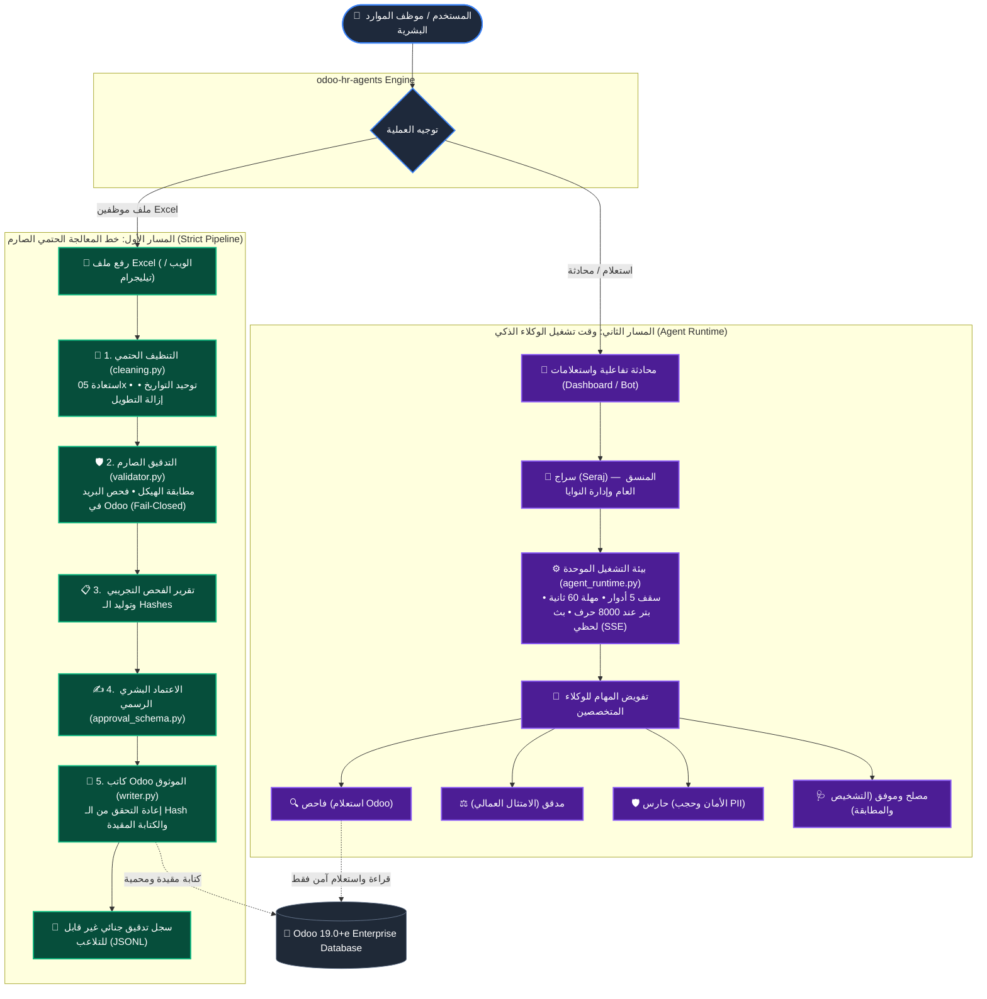
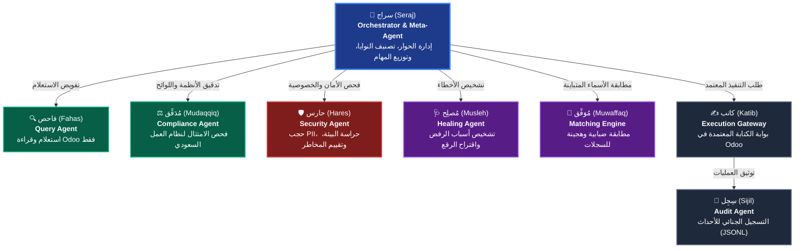

# 🚀 odoo-hr-agents

<div align="center">


**المنظومة الهجينة الذكية لإدارة وأتمتة الموارد البشرية في Odoo 19 Enterprise**  
*تجمع بين خط أنابيب حتمي صارم لمعالجة بيانات Excel، وفريق عمل من 8 وكلاء ذكاء اصطناعي، ومحرك تحليلات متقدم لنسب التوطين ونطاقات وفق نظام العمل السعودي.*

<p align="center">
   &nbsp;
   &nbsp;
   &nbsp;
   &nbsp;
   &nbsp;
   &nbsp;
   &nbsp;
  
</p>

[المميزات](#-أبرز-المميزات) • [معمارية المسارين](#-المعمارية-الهجينة-ذات-المسارين-dual-track) • [فريق الوكلاء الثمانية](#-فريق-الوكلاء-الذكية-the-8-ai-agents) • [محرك التحليلات والتوطين](#-محرك-التحليلات-التنفيذية-ونظام-التوطين-ونطاقات) • [سيناريوهات الاستخدام](#-سيناريوهات-العمل-ورحلة-المستخدم) • [التشغيل السريع](#-التشغيل-السريع-quickstart) • [دليل الـ API](#-دليل-واجهات-البرمجة-core-api-reference)

---

</div>

## 💡 لماذا odoo-hr-agents؟ (المشكلة والحل)

### 🛑 التحديات المؤلمة في إدارة موظفي Odoo بالطرق التقليدية:
- **تشوه أخطاء الإدخال البشري:** برامج Excel تسقط الصفر في بداية أرقام الجوال السعودية (`50x` بدلاً من `050x`)، وتتداخل صيغ التواريخ، وتتكرر الأخطاء الإملائية في الأقسام والوظائف، مما يلوث قاعدة بيانات Odoo.
- **مخاطر الكتابة المباشرة وتكرار الموظفين:** إدخال ملفات Excel بشكل مباشر قد ينشئ موظفين مكررين ببريد إلكتروني موجود مسبقاً، دون تدقيق مسبق ودون سجل تراجع آمن.
- **صعوبة الامتثال لنظام العمل السعودي والتوطين:** غياب المراقبة اللحظية لنسب التوطين (Saudization) وتصنيف "نطاقات" قبل اتخاذ قرار التعيين، وعدم مطابقة شروط ساعات العمل والعقود بشكل آلي.
- **مخاطر الخصوصية والصلاحيات:** إمكانية تسريب بيانات الرواتب الحساسة أو التعديل غير المصرح به على بيئات الإنتاج الحية.

### ✅ الحل المعماري المتكامل:
يقدم مشروع **odoo-hr-agents** حلاً شاملاً عبر **نظام هجين متطور**:
1. **مسار تنظيف وتدقيق حتمي (Deterministic & Fail-Closed):** يصحح البيانات الشائعة تلقائياً، ويتحقق من السجلات في Odoo 19، ويطلب موافقة بشرية موقعة تشفيرياً (`row_hash`) قبل أي كتابة.
2. **منظومة متكاملة من 8 وكلاء ذكاء اصطناعي:** يتولون التنسيق، الاستعلام الآمن، مطابقة البيانات الضبابية، التدقيق العمالي، حراسة الأمان والخصوصية، وتشخيص الأخطاء.
3. **محرك تحليلات تنفيذية ومحاكاة التوطين:** احتساب نطاقات ونسب السعودة ومخصصات التأمينات، مع محاكاة أثر التعيين قبل تنفيذه.

---

## ✨ أبرز المميزات

- 🧹 **مرحلة تنظيف حتمية ذكية (`cleaning.py`):** استعادة الصفر المفقود للجوال السعودي، تحويل الأرقام الفارسية/الهندية إلى لاتينية، توحيد التواريخ غير الملتبسة، وتطهير الكشيدة وحروف الكاف والياء.
- 🛡️ **فحص تكرار آمن (Fail-Closed):** لا يتم قبول أي موظف بصمت إذا انقطع الاتصال بـ Odoo؛ بل يتحول إلى مراجعة بشرية فورية.
- ⚖️ **حراسة أمنية وتدقيق عمالي استباقي:** مدقق ومطابق لقوانين العمل ولوائح وزارة الموارد البشرية، مع حجب تلقائي للبيانات الحساسة PII.
- 📊 **محاكاة التوطين ونطاقات (`simulate-saudization`):** تجربة تعيين الموظفين الجدد واكتشاف أثرهم على نطاق المنشأة بضغطة زر.
- 💬 **محادثة فورية مع Odoo:** استعلام باللغة العربية الطبيعية وسؤال الوكيل الذكي عن الهيكل الإداري والموظفين والإحصائيات.
- 🌐 **واجهات تشغيل متعددة:** لوحة تحكم ويب متكاملة (FastAPI) مع مركز رفع منفصل وبث حي للأحداث (SSE)، إلى جانب بوت تيليجرام تفاعلي.

---

## 🏛️ المعمارية الهجينة ذات المسارين (Dual-Track Architecture)

يعتمد النظام فصلاً تاماً بين عمليات **التعديل والكتابة** الحساسة، وعمليات **الاستعلام والمحادثة**:



---

## 🚀 تفاصيل المسار الأول: خط معالجة ملفات Excel الصارم

جميع ملفات الموظفين تمر عبر مراحل حتمية نقية، لا يتدخل فيها أي نموذج ذكاء اصطناعي باتخاذ قرارات القبول أو التعديل:

1. **المحلل ومرحلة التنظيف الحتمية (`parser.py` + `cleaning.py`):**
   - **الجوال:** معالجة الأرقام العربية/الفارسية، توحيد البادئات الدولية (`+966`)، واستعادة الصفر المفقود تلقائياً (`50xxxxxxx` ← `050xxxxxxx`).
   - **البريد:** تنظيف المسافات والتحويل لأحرف صغيرة (`lower()`).
   - **التاريخ:** تحويل الصيغ الواضحة غير الملتبسة فقط إلى `YYYY-MM-DD`. الحالات الملتبسة (مثل `05-06-2026`) أو التواريخ الهجرية تُترك كما هي ويُبلّغ عنها كـ `cleaning_issues`.
   - **النصوص:** إزالة التطويل (الكشيدة) وتوحيد الحروف الفارسية (`ک` و `ی`).
   - **قالب الموظفين الرسمي:** تخطي صف المثال التوضيحي تلقائياً (`template_example_row_skipped`).
2. **المدقق الصارم (`validator.py`):**
   - مطابقة الشركات والأقسام والمسميات الوظيفية مقابل لقطة Odoo الحية.
   - التحقق من تكرار البريد الإلكتروني في Odoo مع سياسة إغلاق آمنة عند تعذر الاتصال (`Fail-Closed`).
   - تصنيف النتائج إلى: `accepted` (مقبول)، `needs_review` (يحتاج مراجعة)، أو `rejected` (مرفوض).
3. **تقرير الفحص التجريبي (`dry_run_report.py`):**
   - توليد تقرير فحص تفصيلي يحتوي على ملخص الأخطاء، سجل التصحيحات، والتوقيع الفريد لكل صف (`row_hash`).
4. **الموافقة والاعتماد (`approval_schema.py`):**
   - إنشاء ملف اعتماد رسمي مشفر بالتوقيعات لضمان عدم التلاعب بمحتوى الملف بعد الفحص.
5. **الكاتب الموثوق (`writer.py`):**
   - يعيد تحليل الملف من الصفر للتأكد من مطابقة الـ `row_hash` الحية مع التقرير المعتمد.
   - الكتابة المقيدة على سجلات `hr.employee` في Odoo مع التحقق الفوري بعد الإنشاء (`readback`).
   - تسجيل كل عملية في ملف سجلات غير قابل للتعديل (`output/writer_results_*.jsonl`).

> 📖 **تفاصيل معايير الفحص وترتيبها:** راجع وثيقة [دليل الـ Validator وموفق المعتمد](docs/validator_and_matching.md).

---

## 🤖 فريق الوكلاء الذكية (The 8 AI Agents)

يعمل النظام عبر نموذج **تنسيق الوكلاء متعددي المهام (Multi-Agent Orchestration)**؛ يقودهم المنسق العام "سراج"، ويتعاونون تحت بيئة تشغيل موحدة ومحصنة ضد التعليق وانفجار الموارد (`agent_runtime.py`):

### 👥 معرض الوكلاء الذكية (Agent Avatars Gallery)

| <br/>**🧠 سراج (Seraj)**<br/><sub>المنسق العام ومدير النوايا</sub> | <br/>**🔍 فاحص (Fahas)**<br/><sub>الاستعلام وقراءة Odoo</sub> | <br/>**⚖️ مُدَقِّق (Mudaqqiq)**<br/><sub>الامتثال لنظام العمل</sub> | <br/>**🛡️ حارس (Hares)**<br/><sub>الأمان وحجب PII والبيئة</sub> |
| :---: | :---: | :---: | :---: |
| <br/>**🩺 مُصلِح (Musleh)**<br/><sub>التشخيص وعلاج الرفض</sub> | <br/>**🎯 مُوَفِّق (Muwaffaq)**<br/><sub>المطابقة الهجينة الذكية</sub> | <br/>**✍️ كاتب (Katib)**<br/><sub>بوابة الكتابة والتنفيذ</sub> | <br/>**📜 سِجِل (Sijil)**<br/><sub>التوثيق الجنائي (JSONL)</sub> |



### 1. سراج (Seraj) — المنسق العام ومدير المحادثة (The Orchestrator)

<table>
  <tr>
    <td width="90" align="center" valign="top">
      
    </td>
    <td>
      <ul>
        <li><b>الدور:</b> الواجهة العقلية للنظام. يستقبل استفسارات المستخدم، يحلل النية (Intent Classification)، ويفوض المهام إلى الوكلاء المعنيين بترتيب مدروس.</li>
        <li><b>التقنية:</b> محرك LLM تفاعلي مع خط حماية خوارزمي احترازي عند تعذر النماذج.</li>
        <li><b>الملف المرجعي:</b> <code>agents/seraj_meta_agent.py</code> و <code>seraj_llm_service.py</code>.</li>
      </ul>
    </td>
  </tr>
</table>

### 2. فاحص (Fahas) — وكيل الفحص والاستعلام (The Query Agent)

<table>
  <tr>
    <td width="90" align="center" valign="top">
      
    </td>
    <td>
      <ul>
        <li><b>الدور:</b> عين النظام داخل Odoo. ينفذ عمليات البحث والاستعلام والقراءة فقط دون أي صلاحية تعديل.</li>
        <li><b>الأدوات:</b> فحص سجلات الموظفين، البحث عن الشركات، جرد الأقسام، واستخراج بيانات الحضور والإجازات.</li>
        <li><b>الملف المرجعي:</b> <code>fahas_service.py</code>.</li>
      </ul>
    </td>
  </tr>
</table>

### 3. مُدَقِّق (Mudaqqiq) — وكيل الامتثال ونظام العمل (The Compliance Agent)

<table>
  <tr>
    <td width="90" align="center" valign="top">
      
    </td>
    <td>
      <ul>
        <li><b>الدور:</b> قاضي الامتثال القانوني واللوائح السعودية. يفحص توافق البيانات والعقود والإجازات مع <b>نظام العمل السعودي</b>.</li>
        <li><b>المهام الحيوية:</b>
          <ul>
            <li>التحقق من ساعات العمل في شهر رمضان والحدود الأسبوعية (المادتان 98 و 99).</li>
            <li>تدقيق شروط العقود وفترات التجربة ولوائح الجزاءات ونسب ساعات العمل الإضافية.</li>
            <li>إيقاف العمليات التي تنتهك اللوائح وتوجيهها للمراجعة القانونية الفورية.</li>
          </ul>
        </li>
        <li><b>الملف المرجعي:</b> <code>agents/mudaqqiq_agent.py</code>.</li>
      </ul>
    </td>
  </tr>
</table>

### 4. حارس (Hares) — حارس الأمان والخصوصية (The Security Guard Agent)

<table>
  <tr>
    <td width="90" align="center" valign="top">
      
    </td>
    <td>
      <ul>
        <li><b>الدور:</b> حماية البيانات الحساسة وحراسة بوابات الوصول والبيئة الحية.</li>
        <li><b>المهام الحيوية:</b>
          <ul>
            <li><b>حجب البيانات الشخصية والحساسة (Data Masking & PII):</b> إخفاء الهويات وأرقام الحسابات والرواتب في سجلات العرض والدردشة.</li>
            <li><b>حراسة البيئة (Environment Policy Gate):</b> منع أي عملية كتابة على بيئات الإنتاج الحية دون تفويض استثنائي.</li>
            <li><b>تقييم المخاطر (Risk Assessment):</b> فحص الصلاحيات ومنع ثغرات الحقن وتضارب الأوامر.</li>
          </ul>
        </li>
        <li><b>الملف المرجعي:</b> <code>agents/hares_agent.py</code> و <code>environment_policy.py</code>.</li>
      </ul>
    </td>
  </tr>
</table>

### 5. مُصلِح (Musleh) — خبير التشخيص والعلاج (The Healing & Diagnostic Agent)

<table>
  <tr>
    <td width="90" align="center" valign="top">
      
    </td>
    <td>
      <ul>
        <li><b>الدور:</b> تشخيص أسباب رفض الصفوف في ملفات الإكسل، واقتراح حلول ورقع تصحيحية ذكية.</li>
        <li><b>المهام:</b> معالجة التناقضات بين الأقسام والوظائف، تقديم تقارير استشارية لإصلاح الخلل، وتطبيق التصحيحات المعتمدة.</li>
        <li><b>الملف المرجعي:</b> <code>musleh_service.py</code>.</li>
      </ul>
    </td>
  </tr>
</table>

### 6. مُوَفِّق (Muwaffaq) — محرك المطابقة الضبابية الذكي (The Matching Engine)

<table>
  <tr>
    <td width="90" align="center" valign="top">
      
    </td>
    <td>
      <ul>
        <li><b>الدور:</b> حل مشكلات تباين الأسماء والمصطلحات بين الإكسل وقاعدة بيانات Odoo.</li>
        <li><b>التقنية:</b> يعتمد خوارزمية هجينة (<code>difflib</code> SequenceMatcher + مطابقة تامة بعد التطبيع + تعزيز سياق القسم المشترك +0.15) مع نسب ثقة مركزية في <code>matching_thresholds.py</code>.</li>
        <li><b>الملف المرجعي:</b> <code>agents/muwaffaq_agent.py</code> و <code>matching_thresholds.py</code>.</li>
      </ul>
    </td>
  </tr>
</table>

### 7. كاتب (Katib) — منفذ العمليات المعتمدة (The Execution Gateway)

<table>
  <tr>
    <td width="90" align="center" valign="top">
      
    </td>
    <td>
      <ul>
        <li><b>الدور:</b> البوابة الحصرية المخولة بإنشاء وتعديل السجلات في Odoo.</li>
        <li><b>الأمان الصارم:</b> لا يعمل إلا بعد اجتياز التحقق والاعتماد ومطابقة الـ <code>row_hash</code> الحية. معزول تماماً عن صلاحية الحذف العام (<code>unlink</code>).</li>
        <li><b>الملف المرجعي:</b> <code>katib_service.py</code> و <code>writer.py</code>.</li>
      </ul>
    </td>
  </tr>
</table>

### 8. سِجِل (Sijil) — حارس التدقيق الجنائي (The Audit & Provenance Agent)

<table>
  <tr>
    <td width="90" align="center" valign="top">
      
    </td>
    <td>
      <ul>
        <li><b>الدور:</b> التوثيق الشامل غير القابل للتعديل لجميع العمليات.</li>
        <li><b>المهام:</b> توليد ملفات السجلات الجنائية بصيغة JSONL مع أرقام العمليات وتوقيعات الـ Hash لكل صف تم إنشاؤه لضمان التتبع والمصداقية.</li>
        <li><b>الملف المرجعي:</b> <code>agents/sijil_agent.py</code> و <code>sijil_audit_service.py</code>.</li>
      </ul>
    </td>
  </tr>
</table>

---

## 📊 محرك التحليلات التنفيذية ونظام التوطين ونطاقات

يضم النظام محرك تحليلات متقدم ومخصص لبيئة الأعمال السعودية (`analytics_service.py`)، يدعم المتابعة الحية وحساب مؤشرات الأداء (KPIs):

- **مؤشر التوطين ونطاقات (`/api/analytics/workforce`):** احتساب نسب السعودة الحالية وتحديد نطاق المنشأة وفق معايير وزارة الموارد البشرية.
- **محاكاة التوطين الفورية (`/api/analytics/simulate-saudization`):** محاكاة تأثير تعيين موظفين جدد (سعوديين أو مقيمين) على نطاق المنشأة قبل اتخاذ قرار التعيين الفعلي.
- **الالتزامات المالية والتأمينات (`/api/analytics/financial`):** حساب اشتراكات التأمينات الاجتماعية (GOSI)، ومخصصات مكافأة نهاية الخدمة (EOS)، والرواتب.
- **الامتثال والعمليات (`/api/analytics/compliance` و `/api/analytics/operations`):** متابعة سريان الإقامات، عقود العمل، الإجازات، ومعدلات الدوران الوظيفي.

---

## 💼 سيناريوهات العمل ورحلة المستخدم (Real Workflows)

### 📄 السيناريو 1: استيراد وتطهير دفعة موظفين جدد (Excel Onboarding)
1. يقوم موظف الـ HR برفع ملف Excel عبر **مركز الرفع الموحد**.
2. المحلل يمرر الملف عبر `cleaning.py`: يتم تلقائياً استرجاع الأصفار الساقطة من أرقام الجوال، توحيد صيغ التواريخ الواضحة، وتطهير النصوص.
3. المدقق يفحص السجلات مقابل Odoo؛ إذا وُجد بريد مكرر أو قسم غير موجود يُصنف الصف كـ `needs_review` أو `rejected`.
4. يظهر تقرير الـ **Dry-Run** الشامل موضحاً جدول التصحيحات والـ Hashes.
5. يضغط المشرف على "اعتماد وتنفيذ"؛ يقوم الكاتب `writer.py` بإعادة تحليل الملف، مطابقة التوقيعات، وإنشاء الموظفين في Odoo مع تسجيل تقرير JSONL فوري.

### 💬 السيناريو 2: استعلام استراتيجي ومحادثة تفاعلية (Smart HR Chat)
1. يسأل المدير في الشات: *"كم عدد الموظفين في قسم التقنية؟ ومن هم الموظفون الذين تنتهي إقاماتهم الشهر القادم؟"*
2. يستقبل **سراج** السؤال، ويطلب من **فاحص** جلب البيانات من Odoo عبر `execute_query_task`.
3. يتدخل **حارس** لحجب أي بيانات رواتب حساسة، ويصيغ **سراج** إجابة عربية واضحة ودقيقة.

### 📈 السيناريو 3: محاكاة التوطين ونطاقات قبل التعيين (Saudization Simulation)
1. ترغب الشركة في توظيف 3 مهندسين غير سعوديين، وتخشى هبوط نطاقها من الأخضر المرتفع إلى الأخضر المنخفض.
2. عبر استدعاء منفذ المحاكاة `/api/analytics/simulate-saudization`، يقوم محرك التحليلات باحتساب عدد الكوادر الوطنية مقابل الوافدين، وعرض نسبة التوطين المتوقعة والنطاق الناتج فوراً قبل توقيع العقود.

---

## 📂 هيكل المجلدات الرئيسي (Project Tree)

```text
odoo-hr-agents/
├── agents/                   # كود الوكلاء المتخصصين (Seraj, Mudaqqiq, Hares, Muwaffaq, Sijil, ...)
├── config/                   # ملفات ضبط لوحة التحكم وبيئة العمل
├── docs/                     # التوثيق المعماري، دليل الـ Validator، وأدلة الاستخدام
├── graph/                    # تعريف حالات ورسم بياني لـ LangGraph ومسارات الوكلاء
├── memory/                   # إدارة ذاكرة الجلسات وسجلات المحادثة
├── observability/            # مقاييس الأداء (Metrics)، التتبع اللحظي (Tracer)، والرصد
├── templates/                # قوالب HTML للوحة التحكم والقوالب المعيارية (Excel)
├── tests/                    # حزمة الاختبارات الآلية الشاملة (+700 اختبار)
├── agent_runtime.py          # محرك تشغيل دورات استدعاء الأدوات الموحد والمهل
├── analytics_service.py      # محرك التحليلات السعودية (نطاقات، التأمينات، محاكاة التوطين)
├── cleaning.py               # مرحلة التنظيف الحتمية للمدخلات العربية
├── dry_run_report.py         # بناء تقارير الفحص التجريبي وتوليد الـ Hashes
├── matching_thresholds.py    # ثوابت وعتبات نسب التشابه الموحدة
├── parser.py                 # محلل ملفات Excel واستخراج الحقول
├── seraj_llm_service.py      # خدمة التنسيق والمحادثة الذكية لسراج
├── validator.py              # المدقق الصارم وقواعد المطابقة مع Odoo
├── web_service.py            # تطبيق FastAPI الرئيسي والواجهة الموحدة
└── writer.py                 # كاتب Odoo الموثوق وإعادة التحقق من التوقيعات
```

---

## ⚡ التشغيل السريع (Quickstart)

### المتطلبات الأساسية
- **Python:** 3.12 أو أحدث.
- **Odoo:** Odoo 19.0+e Enterprise (صلاحيات قراءة وإنشاء على موديل `hr.employee`).
- **نموذج الذكاء الاصطناعي:** Ollama محلي (الموديل الموصى به: `qwen3.5:9b`) أو مفتاح سحابي (Groq / OpenAI / Anthropic).

### 1. إعداد المتغيرات (`.env`)
أنشئ ملف `.env` في المجلد الرئيسي واضبط الإعدادات التالية:

```bash
# -------------------------------------------------------------
# 1. إعدادات الاتصال بـ Odoo 19 Enterprise
# -------------------------------------------------------------
ODOO_URL=https://your-odoo19-instance.com
ODOO_DB=your_database_name
ODOO_USERNAME=your_username
ODOO_API_KEY=your_api_key_or_password

# -------------------------------------------------------------
# 2. أمان الويب ورموز الكتابة (مهم جداً للإنتاج)
# -------------------------------------------------------------
AGENT_WRITE_TOKEN=your_strong_secret_token_here

# -------------------------------------------------------------
# 3. إعدادات نماذج الذكاء الاصطناعي (المحلي الموصى به)
# -------------------------------------------------------------
LLM_PROVIDER=ollama
OLLAMA_MODEL=qwen3.5:9b
OLLAMA_BASE_URL=http://localhost:11434

# أو استخدام المزودات السحابية (اختياري)
# GROQ_API_KEY=gsk_...
# OPENAI_API_KEY=sk-...

# -------------------------------------------------------------
# 4. بوت تيليجرام (اختياري)
# -------------------------------------------------------------
# TELEGRAM_BOT_TOKEN=your_telegram_bot_token_here
```

### 2. تثبيت التبعيات وبدء التشغيل

```powershell
# تثبيت المتطلبات
pip install -r requirements.txt

# تشغيل الخادم والواجهة الموحدة (Windows)
.\start_chat.bat

# أو تشغيل خادم FastAPI مباشرة
uvicorn web_service:app --host 0.0.0.0 --port 8000 --reload
```

افتح المتصفح على الرابط: **`http://localhost:8000`**

---

## 📡 دليل واجهات البرمجة (Core API Reference)

| المسار (Endpoint) | الطريقة | الحماية المطلوبة | الوظيفة التقنية |
|---|---|---|---|
| **`/api/upload`** | `POST` | مفتوح للجلسة | رفع ملف Excel وفحصه المبدئي وحفظه في الجلسة |
| **`/api/dry-run`** | `POST` | مفتوح للجلسة | تنفيذ الفحص التجريبي الصارم وتوليد تقرير الـ Hashes |
| **`/api/approve`** | `POST` | `X-Write-Token` | اعتماد الصفوف المقبولة وتوليد تصريح الكتابة |
| **`/api/write`** | `POST` | `X-Write-Token` | تنفيذ الكتابة المقيدة في Odoo للصفوف المعتمدة |
| **`/api/write/{run_id}/stream`** | `GET` | مفتوح للجلسة | بث أحداث الكتابة اللحظي للمشرف (Server-Sent Events) |
| **`/api/analytics/dashboard`** | `GET` | مفتوح للجلسة | لوحة المؤشرات التنفيذية والإحصائيات الشاملة |
| **`/api/analytics/workforce`** | `GET` | مفتوح للجلسة | مؤشرات التوطين، نسبة السعودة، وتصنيف نطاقات |
| **`/api/analytics/simulate-saudization`**| `POST` | مفتوح للجلسة | محاكاة فورية لتأثير التعيين الجديد على نطاق الشركة |
| **`/api/template/generate`** | `POST` | مفتوح للجلسة | توليد نموذج Excel رسمي للموظفين معتمد ومتوافق مع Odoo |
| **`/api/leaves/summary/{emp_id}`** | `GET` | مفتوح للجلسة | استعلام رصيد وسجل إجازات موظف محدد |
| **`/api/status`** | `GET` | عام | فحص جاهزية النظام والاتصال بقاعدة Odoo |

> 🔒 **ملاحظة أمنية:** جميع منافذ التعديل والكتابة تتطلب ترويسة أمان `X-Write-Token: <AGENT_WRITE_TOKEN>` في الـ Header لمنع أي استدعاءات غير مصرح بها.

---

## 🧪 الاختبارات وضمان الجودة (Testing Suite)

المشروع مغطى بحزمة اختبارات مكثفة تتجاوز **700 اختبار آلي** تغطي كافة المسارات الحتمية، الوكلاء، وحالات الخطأ:

```powershell
# تشغيل جميع اختبارات المسار الحتمي ووقت تشغيل الوكلاء
pytest tests/test_*.py -q

# تشغيل اختبارات وقت تشغيل الوكلاء الجديد (Agent Runtime)
pytest tests/test_agent_runtime.py -v

# تشغيل اختبارات مرحلة تنظيف البيانات والحالات المتسقة
pytest tests/test_cleaning_stage.py tests/test_failure_code_status_consistency.py -v

# تشغيل اختبارات التحقق من نظام العمل والمدقق
pytest tests/test_labor_law_mudaqqiq_routing.py tests/test_mudaqqiq_agent.py -v
```

---

## 🔒 الأمان وحوكمة البيانات (Enterprise Governance)

1. **عزل صلاحيات الحذف بالكامل (`Unlink Isolation`):** بوابة الكتابة `OdooWriteGateway` لا تحتوي كودياً على أي صلاحية حذف. أدوات التنظيف معزولة في بوابة خاصة `OdooCleanupGateway`، وتتطلب تأكيداً يدوياً صريحاً `--confirm` ومطابقة حية للبريد.
2. **فحص البيئات الصارم (`Environment Policy`):** منع الكتابة على أي بيئة إنتاج حية إلا بشروط صريحة واستثنائية ومحصورة في قواعد Odoo 19 المصرح بها.
3. **حماية الخصوصية ومراقبة الجلسات:** يتولى الوكيل "حارس" إخفاء البيانات الشخصية (PII Masking) لضمان عدم تسريب الرواتب والبيانات الحساسة في السجلات.
4. **التطابق التشفيري (`Hash Provenance`):** لا يمكن إدخال أي سجل إلى Odoo إذا تم تعديل حرف واحد في الملف بين مرحلتي الفحص والاعتماد.
5. **حماية الـ Endpoints برمز أمان قوي:** يُلزم بتعيين رمز كتابة معقد (`AGENT_WRITE_TOKEN`) لا يقل عن 32 خانة وتفعيل بروتوكول HTTPS في البيئات الإنتاجية.

---

## 📚 وثائق ومراجع إضافية
- [دليل الـ Validator وموفق المعتمد من الكود](docs/validator_and_matching.md)
- [دليل استخدام الواجهة الموحدة](docs/UNIFIED_DASHBOARD_GUIDE.md)
- [خطة التدقيق والمطابقة وإدارة الفشل](failure_codes.py)

---

<div align="center">
صُمم وطُوّر بأعلى معايير الأمان البرمجي لبيئات الأعمال والموارد البشرية السعودية 🇸🇦
</div>
