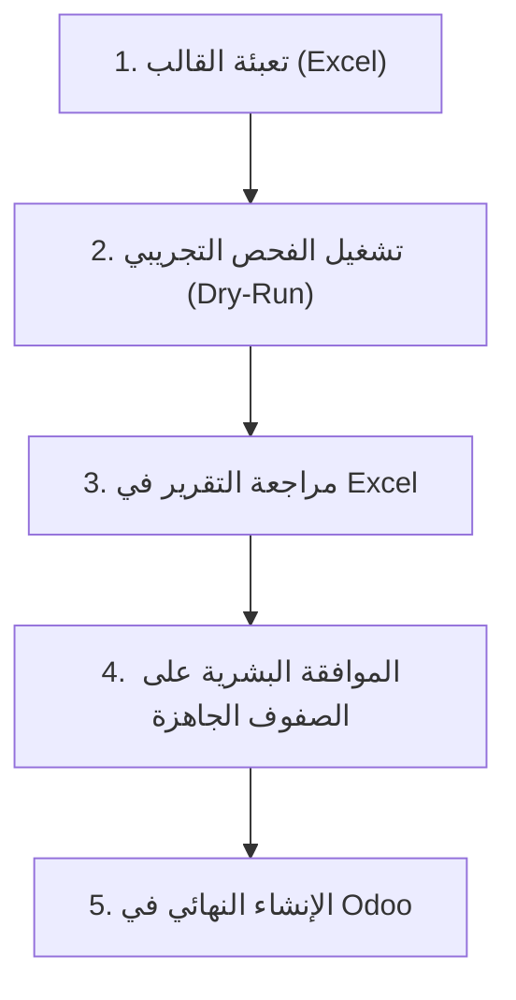

# دليل التشغيل لمسؤول الموارد البشرية (HR User Guide)
## نظام أتمتة إدخال الموظفين في Odoo (Odoo HR Agents)

مرحباً بك! هذا الدليل مُعَدّ خصيصاً لمسؤولي الموارد البشرية وإدارة شؤون الموظفين. يشرح الدليل — بخطوات واضحة وبلغة إدارية غير تقنية — كيفية تجهيز بيانات الموظفين واستيرادها إلى نظام Odoo بكل أمان وموثوقية، دون أي قلق من حدوث أخطاء أو إنشاء سجلات مكررة.

---

## 💡 فكرة النظام ومبدأ الأمان الأساسي

صُمم هذا النظام وفق مبدأ **"الفحص الشامل قبل أي خطوة"**:
1. **النظام لا يُنشئ أي موظف فوراً بمجرد رفع الملف.**
2. يمر الملف أولاً بـ **فحص تجريبي آمن (Dry-Run)** يُطابق كل صف مع بيانات Odoo الحقيقية ويولد لك تقريراً تفصيلياً بأي ملاحظة أو خطأ.
3. **لا يدخل أي موظف إلى Odoo إلا بعد مراجعتك البشرية الصريحة وموافقتك برقم كل صف.**

---

## 🔄 مسار العمل في 5 خطوات بسيطة



---

## الخطوة 1: الحصول على القالب وتعبئته

### أ. كيفية الحصول على أحدث قالب
يحتوي القالب دائماً على أحدث قائمة بالأقسام والوظائف المعتمدة في Odoo. لتوليد قالب جديد:
افتح موجه الأوامر (Terminal / PowerShell) واكتب:
```bash
python generate_employee_template.py
```
سيتولد ملف Excel في مجلد `samples/` يحمل تاريخ اليوم باسم:
`samples/employee_import_template_YYYYMMDD.xlsx`

### ب. بنية ملف القالب
يحتوي ملف القالب على ثلاث أوراق عمل (Sheets):
1. **`Employees` (ورقة الموظفين)**: الورقة المخصصة لإدخال بيانات موظفيك الجدد.
2. **`Reference` (المرجع - للقراءة فقط)**: قائمة كاملة بأسماء الشركات، الأقسام، والمسميات الوظيفية المعتمدة حالياً في Odoo.
3. **`Instructions` (التعليمات)**: دليل مدمج داخل الملف يشرح كل حقل مع أمثلة صحيحة وخاطئة.

### ج. شرح أعمدة ورقة `Employees`

| العمود | اسم الحقل بالإنجليزية | هل هو إلزامي؟ | ما الذي يجب كتابته؟ | مثال صحيح | تنبيه هام |
|---|---|---|---|---|---|
| **الاسم الكامل** | `name` | **نعم (إلزامي)** | الاسم الثلاثي أو الرباعي للموظف | محمد أحمد الحربي | تجنب الرموز أو الأسماء المفردة |
| **الشركة** | `company` | **نعم (إلزامي)** | اسم الشركة كما هو مسجل في Odoo | شركة النخبة الذكية للتقنية | راجع ورقة `Reference` للدقة |
| **البريد الإلكتروني** | `work_email` | اختياري (موصى به) | البريد الرسمي للموظف | m.alharbi@al-nokhba.com | يجب أن يكون بصيغة بريد صحيحة |
| **رقم الجوال** | `mobile_phone` | اختياري (موصى به) | رقم الاتصال | 0501234567 | أرقام صحيحة بلا مسافات زائدة |
| **القسم / الإدارة** | `department` | اختياري | القسم الذي ينتمي له الموظف | الموارد البشرية | انسخه من ورقة `Reference` |
| **المسمى الوظيفي** | `job_title` | اختياري | المسمى الوظيفي للموظف | أخصائي توظيف | انسخه من ورقة `Reference` |
| **نوع التوظيف** | `employment_type` | اختياري | دوام كامل، دوام جزئي، تدريب، عقد محدد | Full-time | اختياري |
| **الموقع / الفرع** | `work_location` | اختياري | المدينة أو الفرع | الرياض - المقر الرئيسي | اختياري |
| **تاريخ التعيين** | `hiring_date` | اختياري | تاريخ مباشرة الموظف للعمل | 2026-10-01 | بصيغة سنة-شهر-يوم (YYYY-MM-DD) |

> ⚠️ **ملاحظة ذهبية**: قبل كتابة أي قسم أو مسمى وظيفي، افتح ورقة `Reference` وتأكد أنه موجود ومفعّل. إذا كان القسم جديداً وغير موجود في Odoo، تواصل مع مسؤول النظام لإضافته أولاً في Odoo.

---

## الخطوة 2: تشغيل الفحص التجريبي الآمن (Dry-Run)

بعد حفظ ملف الإكسل (مثلاً باسم `new_hires.xlsx`)، شغّل أمر الفحص:

```bash
python run_dry_run.py new_hires.xlsx
```

### ماذا يفعل هذا الأمر؟
- يقرأ الملف ويتأكد من خلوه من الأخطاء التنسيقية.
- يتحقق من قواعد بيانات Odoo: هل الشركة صحيحة؟ هل القسم موجود؟ هل هذا الموظف مكرر؟
- **لا يكتب أو يعدل أي شيء في Odoo إطلاقاً.**
- يُخرج ملخصاً سريعاً على الشاشة:
```text
Dry-run complete.
run_id: a1b2c3d4e5f6...
total_rows: 5
accepted: 3
needs_review: 1
rejected: 1
output_folder: output/a1b2c3d4e5f6_20261005T010000Z
```

---

## الخطوة 3: قراءة التقرير وفهم الحالات

توجه إلى المجلد الموضح في مخرج الشاشة: `output/<رقم_التشغيل>/`
ستجد ملف تقرير إكسل: `dry_run_report.xlsx` افتحه لمراجعة حالة كل صف.

### جدول معاني الحالات الأربع

| الحالة | المعنى الإداري البسيط | ماذا يعني لموظف الموارد البشرية؟ | ما الإجراء المطلوب منك؟ |
|---|---|---|---|
| **`accepted`** | **جاهز للاستيراد** | البيانات سليمة 100% ومطابقة لـ Odoo. | لا شيء، هذا الصف جاهز لتعتمد موافقتك عليه في الخطوة 4. |
| **`needs_review`** | **يحتاج انتباهك ومراجعتك** | البيانات مقبولة لكن يوجد تنبيه ذكي (مثلاً: احتمال تكرار اسم موظف، أو عدم وجود بريد، أو قسم قديم). | راجع سبب التنبيه في عمود الملاحظات؛ إذا تأكدت أنه موظف جديد فعلاً، يمكنك اعتماده. |
| **`rejected`** | **مرفوض ولن يُنشأ** | خطأ يمنع إنشاء السجل (مثل بريد إلكتروني بصيغة خاطئة، أو قسم غير موجود مطلقاً في Odoo). | صحّح الخطأ في ملفك الأصلي وأعد تشغيل الفحص. لن يسمح النظام بإنشاء هذا الصف. |
| **`outcome_uncertain`** | **حالة غير محددة (نادرة جداً)** | حدث انقطاع مفاجئ في الاتصال أثناء مرحلة الكتابة السابقة ولا يُعلم مصير السجل. | **لا تُعد المحاولة بنفسك** إطلاقاً، وتواصل فوراً مع الدعم التقني لتأكيد حالة السجل في Odoo. |

### أشهر رموز الملاحظات وكيف تعالجها

* **`REFERENCE_NOT_FOUND`**: القسم أو المسمى الوظيفي غير موجود في Odoo بهذا الاسم.
  * *الحل*: انسخ الاسم المطابق حرفياً من ورقة `Reference` في القالب.
* **`POSSIBLE_DUPLICATE_EXISTING_EMPLOYEE`**: يوجد موظف في Odoo يحمل نفس الاسم أو الجوال.
  * *الحل*: تأكد هل هو نفس الشخص أعيد تسجيله؟ أم تشابه أسماء لموظف جديد تماماً؟
* **`INVALID_EMAIL_FORMAT`**: صيغة البريد غير صحيحة (مثلاً ناقصة `@` أو `.com`).
  * *الحل*: صحح كتابة البريد في ملف الإكسل.
* **`COMPANY_MISMATCH`**: القسم المكتوب يتبع لشركة أخرى غير الشركة المحددة للموظف.
  * *الحل*: تأكد من تبعية القسم للشركة الصحيحة من ورقة `Reference`.

---

## الخطوة 4: إصدار قرار الموافقة الصريح (Approval)

النظام لن يُنشئ أي سجل بناءً على افتراضات. أنت المسؤول البشري الذي يحدد ما يُنشأ وما يُستبعد.

### 1. استعراض الصفوف الجاهزة
```bash
python make_approval.py --report output/<اسم_المجلد>/dry_run_report.json --list
```
سيظهر لك جدول بأرقام الصفوف وحالاتها.

### 2. اعتماد الصفوف المؤكدة
حدد أرقام الصفوف في ملف الإكسل التي تريد إنشاءها فعلياً (مثلاً الصفوف 2 و 3 و 5):
```bash
python make_approval.py --report output/<اسم_المجلد>/dry_run_report.json --input new_hires.xlsx --approved-by "اسمك" --rows 2 3 5
```
ينتج عن هذا الأمر ملف موثق رسمي باسم `approval.json`.
> 🔒 **حماية أمنية**: النظام سيرفض الأمر تلقائياً إذا حاولت إدخال رقم صف حالته `rejected`.

---

## الخطوة 5: الإنشاء الفعلي في Odoo

الآن فقط، يمكنك تشغيل الكاتب الفعلي لإدخال الموظفين الموافق عليهم:

```bash
python writer.py --input new_hires.xlsx --report output/<اسم_المجلد>/dry_run_report.json --approval approval.json --output-dir output/<اسم_مجلد_النتائج> --company-id 15
```
*(ملاحظة: استبدل `15` برقم الشركة المطلوب الإنشاء فيها، مثل: 15 لشركة النخبة، أو 17 لشركة العقار).*

### ماذا يفعل الكاتب؟
1. يعيد التحقق الفوري (Live Re-validation) من قاعدة البيانات قبل كل صف لضمان عدم حدوث أي تغيير أثناء مراجعتك.
2. ينشئ الموظف في Odoo.
3. يقرأ السجل من Odoo ويتأكد من إنشائه بنجاح مع تسجيل رقم الموظف الجديد في ملف النتائج `writer_results_*.jsonl`.
4. يطبع ملخصاً بنجاح العملية.

---

## 🌐 البديل الأسهل: بوابة الويب التفاعلية (Web Dashboard)

بدلاً من استخدام سطر الأوامر، يمكنك تشغيل **بوابة الويب التفاعلية** المتكاملة لإنجاز كافة الخطوات بنقرات زر في المتصفح:

### 1. تشغيل البوابة
```bash
python web_service.py
```
ثم افتح الرابط التالي في متصفحك: **`http://localhost:8000`**

### 2. مميزات البوابة في المتصفح:
1. **سحب وإفلات ملف الإكسل**: اسحب الملف مباشرة إلى المتصفح لتشغيل الفحص الفوري.
2. **جدول تفاعلي بالبيانات**: استعراض أسماء الموظفين، إيميلاتهم، مسمياتهم الوظيفية، وتواريخ تعيينهم مع شارات الحالة (`accepted`, `needs_review`, `rejected`).
3. **اعتماد بنقرة واحدة (Checkboxes)**: يمكنك تحديد الموظفين المعتمدين وتعيين اسم المسؤول المعتمد (`approved_by`).
4. **الإنشاء المباشر في Odoo**: زر مباشر لتنفيذ الإنشاء مع شريط متابعة فوري وعرض أرقام المعرفات (IDs) لكل موظف.
5. **إشعارات تيليقرام التلقائية**: إذا كانت إعدادات تيليقرام مفعّلة في ملف `.env`، سيصلك إشعار فوري على هاتفك لحظة انتهاء الدفعة يحتوي على ملخص الموظفين المنشئين.

---

## 🛡️ خصوصية البيانات والاحتفاظ بها

تطبيقاً لسياسة المنشأة ونظام حماية البيانات الشخصية السعودي (PDPL):
* جميع ملفات النتائج تُحفظ محلياً في مجلد `output/` على جهازك فقط.
* **ممنوع تماماً** نسخ أو إرسال تقارير الموظفين عبر البريد الخارجي أو رفعها على أدوات ذكاء اصطناعي خارجية (مثل ChatGPT وغيره).
* تقارير الفحص غير المعتمدة تُحذف دورياً بعد 30 يوماً.
* لمعرفة حالة التقارير المخزنة على جهازك وتشغيل التنظيف الدوري بأمان:
  ```bash
  python manage_retention.py --list
  ```

---

## ❓ متى تتواصل مع الدعم التقني؟

تواصل مع فريق الدعم التقني في الحالات التالية:
1. ظهور رسالة خطأ باللون الأحمر تتعلق بـ **الاتصال أو مفتاح الـ API** (`ConnectionError` أو `AccessDenied`).
2. ظهور حالة **`outcome_uncertain`** لأي صف أثناء الإنشاء (لا تحاول إعادة الإنشاء منعاً للتكرار).
3. الحاجة لإضافة شركة جديدة كلياً إلى النظام أو صلاحيات خاصة على أقسام جديدة.
4. تعطل سكربت التوليد أو واجهة سطر الأوامر.
