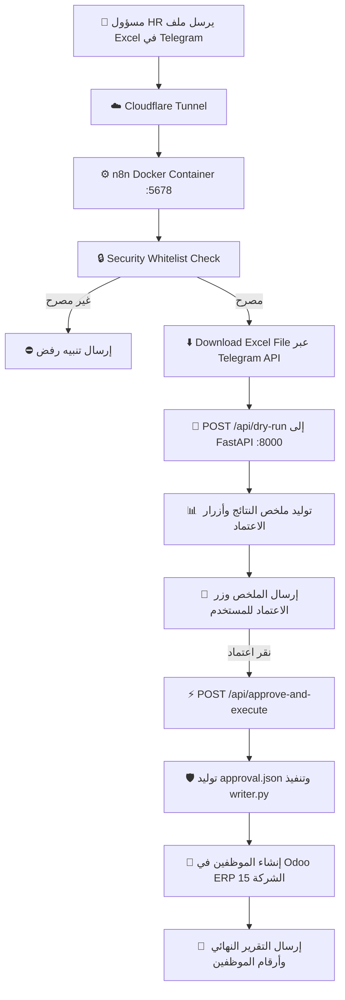

# دليل تشغيل مسار ن8ن وتيليقرام (n8n & Telegram Workflow)

## 📌 نظرة عامة
مسار عمل متكامل ومؤتمت بالكامل مبني على **n8n** ومربوط ببوت تيليقرام وخدمة **FastAPI** الخاصة بمشروع أتمتة إدخال الموظفين في **Odoo ERP**.

---

## 🏗️ الأرشيتكتشر وتدفق البيانات (Architecture Flow)



---

## 🛠️ المشاكل التي تم إصلاحها بالكامل

1. **إصلاح ترميز اللغة العربية (UTF-8):**
   - تم استبدال جميع النصوص المعطوبة وعلامات الاستفهام (`????`) بنصوص عربية نقية وواضحة ومنسقة بنظام Markdown ورموز تعبيرية ملائمة لكل حالة.

2. **تحميل الملفات عبر Node تيليقرام الأصلي (`telegram:file:get`):**
   - الاستغناء عن الروابط الخارجية المعقدة ومتغيرات `$vars.TELEGRAM_BOT_TOKEN` التي كانت تسبب فشلاً.
   - استخدام عقدة تيليقرام الرسمية المربوطة ببيانات الاعتماد (`jCdlB4YPyJxECyUz / Telegram account`) مباشرة.

3. **مرونة استقبال الملفات في `/api/dry-run`:**
   - تم تحديث نقطة النهاية في FastAPI لتقبل الملفات بصيغة `multipart/form-data` أو كـ `binary stream` مباشر من n8n دون أي تعارض (حل مشكلة `422 Unprocessable Entity`).

4. **إضافة نقطة نهاية موحدة `/api/approve-and-execute`:**
   - سابقاً كان الـ workflow يحاول تنفيذ `/api/execute` دون وجود ملف الاعتماد `approval.json`.
   - الآن يتم توليد `approval.json` رسمياً وتوثيق هوية المعتمد عبر تيليقرام، ثم استدعاء `writer.py` مع حماية `EnvironmentGuard` وحد أمان أقصى `max_rows=10`.

5. **فحص الصلاحيات والقائمة البيضاء (Whitelist):**
   - التحقق الصارم من معرف المحادثة والمستخدم (`696492053`) لمنع أي وصول غير مصرح به.

---

## 🚀 كيفية الاستخدام والتشغيل

### 1. التأكد من تشغيل الخدمات:
- **FastAPI Web Service:** يعمل على `http://localhost:8000`
- **Docker n8n:** يعمل على `http://localhost:5678`
- **Cloudflare Tunnel:** يوجه الرابط الخارجي (HTTPS) إلى `http://localhost:5678`

### 2. تفعيل الـ Webhook:
الويب هوك مربوط ومفعل تلقائياً على عنوان الـ Tunnel الحالي:
```
https://classical-paperback-paragraphs-eagles.trycloudflare.com/webhook/FnkQptJrIZaEsmCX/telegram%20trigger/webhook
```

### 3. تجربة الاستيراد في تيليقرام:
1. افتح المحادثة مع البوت في تيليقرام.
2. أرسل ملف الإكسل (`.xlsx`) مباشرة إلى الشات.
3. ستصلك رسالة استلام فوري، تليها رسالة ملخص الفحص التجريبي مع أزرار تفاعلية:
   - `🚀 اعتماد وإنشاء (X) في Odoo`
   - `❌ إلغاء`
4. عند النقر على اعتماد، يقوم النظام فوراً بإنشاء الموظفين المقبولين في Odoo وإرجاع تقرير نهائي بأسمائهم وأرقامهم (Odoo IDs).
